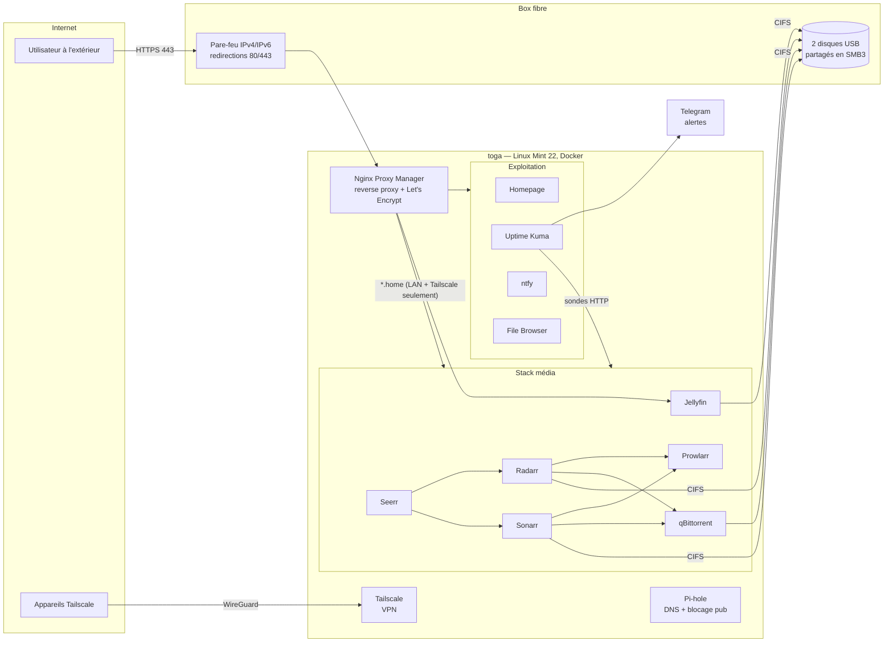

# toga — serveur multimédia auto-hébergé

Serveur domestique construit, administré et sécurisé seul, sur un mini-PC recyclé
(Gigabyte Brix, Celeron N3000 2 cœurs, 4 Go de RAM). Il sert de médiathèque
(films et séries en streaming), de DNS filtrant pour toute la maison, et il est
supervisé avec alertes sur téléphone.

Ce dépôt contient l'infrastructure sous forme de code : fichiers Docker Compose,
configuration du tableau de bord, scripts d'exploitation et documentation.
Les secrets (clés d'API, mots de passe, jetons) n'y figurent pas : ils restent
sur le serveur dans des fichiers `.env` non versionnés (voir les `*.example`).

> Les adresses, noms de domaine et identifiants de ce dépôt sont anonymisés
> (`192.168.1.10`, `media.example.com`, `/home/admin`…).

---

## Architecture



## Services

| Service | Rôle | Accès |
|---|---|---|
| **Jellyfin** | Streaming des films et séries (lecture directe, sans transcodage : le CPU est trop faible) | `https://media.example.com` (public, HTTPS) et `jellyfin.home` |
| **Seerr** | Demandes de films/séries par les utilisateurs | `seerr.home` |
| **Radarr / Sonarr** | Gestion automatique des films / séries | `radarr.home`, `sonarr.home` |
| **Prowlarr** | Gestion des indexeurs | `prowlarr.home` |
| **qBittorrent** | Téléchargements | `qbittorrent.home` |
| **Nginx Proxy Manager** | Reverse proxy, noms `*.home`, certificat Let's Encrypt, listes d'accès | admin sur le port 81 (LAN) |
| **Pi-hole** (natif) | DNS de toute la maison + blocage des pubs + enregistrements locaux `*.home` | `pihole.home` |
| **Tailscale** (natif) | Accès distant chiffré à tous les services d'administration | — |
| **Homepage** | Tableau de bord avec widgets (état, files d'attente, disques) | `home.home` |
| **Uptime Kuma** | Supervision : 12 sondes HTTP + 1 sonde « push » pour les disques | `kuma.home` |
| **ntfy** | Historique local des notifications | `ntfy.home` |
| **File Browser** | Gestionnaire de fichiers web sur les 3 espaces de stockage | `cloud.home` |

## Organisation du dépôt

```
jellyfin/docker-compose.yml   stack média (Jellyfin, *arr, qBittorrent, Seerr, File Browser)
npm/docker-compose.yml        Nginx Proxy Manager (réseau Docker externe proxy-network)
homepage/                     tableau de bord : compose, config YAML, .env.example
monitoring/                   Uptime Kuma + ntfy, script de contrôle des disques
freebox/fbx.sh                client minimal de l'API de la box (authentification HMAC-SHA1)
bin/                          scripts d'exploitation (sauvegarde, optimisation, migration SMB3…)
system/                       montages fstab des disques réseau et crontab
docs/journal.md               journal des interventions : problèmes, diagnostics, corrections
```

## Réseau et sécurité

- **Deux niveaux d'exposition.** Seul Jellyfin est publié sur internet, en HTTPS
  (Let's Encrypt, renouvellement automatique, redirection HTTP→HTTPS, HTTP/2).
  Tous les autres services passent par des noms `*.home` protégés par une
  **liste d'accès NPM « LAN + Tailscale »** : inaccessibles depuis internet.
- **Ports ouverts sur la box : 80 et 443** (vers NPM) et le port BitTorrent.
  Le port direct de Jellyfin (8096, HTTP en clair) a été fermé une fois le HTTPS en place.
- **Pare-feu IPv6 de la box activé** : sans lui, tous les services du serveur
  étaient joignables depuis internet par son adresse IPv6 publique.
- **WPS désactivé** sur tous les réseaux Wi-Fi ; **bail DHCP réservé** pour le serveur.
- **Administration à distance uniquement par Tailscale** (WireGuard).
- **Secrets hors du code** : `.env` / fichiers `chmod 600` lus par les scripts,
  jamais affichés ; jetons saisis avec `read -s`.

## Supervision et alertes

- **Uptime Kuma** interroge chaque service toutes les 60 s (endpoints de santé :
  `/health`, `/ping`, `/api/v1/status`…), avec 2 essais avant alerte.
- **Disques réseau** : `monitoring/check-disques.sh` (cron toutes les 5 min)
  vérifie que les partages sont montés, qu'ils répondent (`timeout` pour ne pas
  rester bloqué si la box ne répond plus) et qu'ils sont remplis à moins de 90 %,
  puis pousse l'état vers une sonde « push » de Kuma.
- **Alertes sur téléphone via un bot Telegram.** ntfy a d'abord été essayé, mais
  les notifications iOS n'arrivaient pas ; ntfy reste en historique local.

## Sauvegardes

`bin/homeserver-backup.sh`, lancé chaque nuit par cron :
- copie **cohérente** des bases SQLite avec l'API `backup` de SQLite
  (les applications tournent pendant la sauvegarde) ;
- archive des configurations vers un disque réseau, **rotation sur 7 jours** ;
- refuse d'écrire si le disque réseau n'est pas monté (pour ne pas remplir le disque local).

Chaque modification manuelle de configuration est précédée d'une copie horodatée
dans `~/backups/` sur le serveur.

## Optimisation d'une machine modeste (4 Go de RAM)

- Démarrage sans interface graphique, services de bureau désactivés, `vm.swappiness=10`.
- Journaux système limités à 200 Mo, logs Docker en rotation (10 Mo × 3).
- Limites mémoire sur les conteneurs de supervision (`mem_limit`).
- Services inutilisés arrêtés (FlareSolverr placé dans un *profile* Compose).
- Pi-hole allégé : historique en mémoire réduit de 24 h à 12 h (214 → 110 Mo de RAM).
- Jellyfin : génération des vignettes et extraction des chapitres désactivées.

## Déployer

```bash
docker network create proxy-network
cd npm        && docker compose up -d
cd jellyfin   && docker compose up -d
cp homepage/.env.example homepage/.env      # puis renseigner les clés
cd homepage   && docker compose up -d
cp monitoring/disques.env.example monitoring/disques.env && chmod 600 monitoring/disques.env
cd monitoring && docker compose up -d
```

Pi-hole et Tailscale sont installés directement sur l'hôte (paquets officiels).

## Compétences mises en œuvre

Linux (systemd, cron, fstab/CIFS, sysctl), Docker et Docker Compose, reverse proxy
et TLS, DNS, réseau domestique (NAT, IPv6, Wi-Fi, CPL), VPN, supervision et
alerting, sauvegarde, scripts Bash et Python, API REST, diagnostic de pannes et
documentation. Le détail des incidents résolus est dans [`docs/journal.md`](docs/journal.md).
